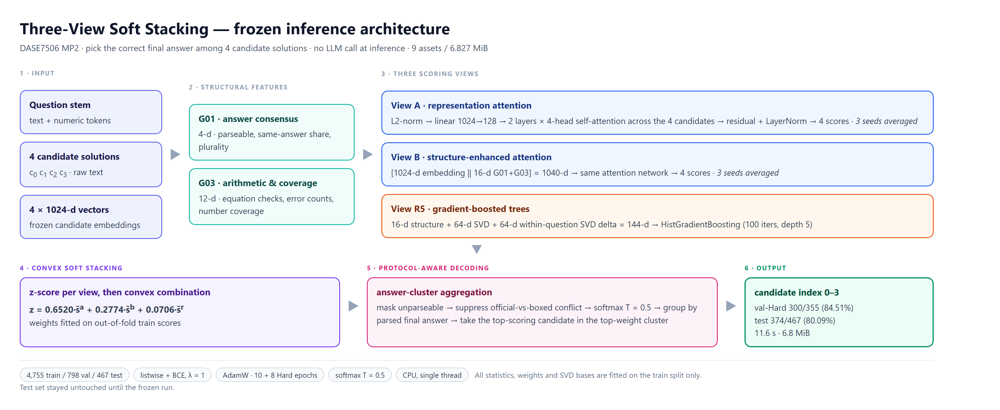

# Best-of-N in Math - Candidates' Reasoning Selection

## Task

This project implements DASE7506 MP2: select one of the four candidate solutions already generated for the same maths problem. The program reads the question, the four candidate texts and the fixed 1,024-dimensional representation of each candidate, and returns one candidate index from 0 to 3 for each question. The official scorer checks the selected candidate's final numeric answer; equivalent fractions and decimals count as correct. A question may have more than one correct candidate, and any correct choice earns the point. The score concerns the final answer, not a formal proof of every reasoning step.

## Development

Development started from majority voting by final-answer frequency. The experiments that followed compared, in order, surface style, arithmetic and number coverage, pointwise scoring, cross-candidate attention, gradient-boosted trees and model fusion. A model that uses only length, formatting and confident wording scores below majority voting. Arithmetic checks improve the weaker consensus model, but do not stably improve the attention model that already reads the full candidate representations. Cross-candidate attention outperforms this project's pointwise baseline and became the main architecture. After the Soft Stacking architecture of the two attention arms (Arm A and Arm B) and the R5 tree was fixed, further tests added a character-text branch, hard-example weighting, decoder alignment, geometric centroids and pairwise energy ranking. None of them surpassed this three-view system. That version was therefore frozen, and the test split was run for submission.

## Frozen version

The frozen method is three-view Soft Stacking. The inputs, structural features, three scoring views, question-standardized scores and convex combination, answer-cluster aggregation, and the returned candidate index are shown below.

Inference loads the nine files in `frozen/model_bundle/`: six attention weight files, one tree, the SVD and the configuration. The fusion weights, temperature 0.5 and the validity/conflict masks are stored in the configuration. Normalization statistics, model weights and the SVD basis are fitted on the training split only.

## Scores on each split

| Split | Correct | Accuracy |
| --- | ---: | ---: |
| Validation | 743/798 | 93.107769% |
| Validation disagreement subset | 300/355 | 84.507042% |
| Validation easy subset | 443/443 | 100% |
| Test | 374/467 | 80.08565310492506% |

The training split is used for fitting; the table lists validation and test only. All 467 test questions are disagreement questions. The primary test run and a second fresh-process reproduction have the same official `accuracy`, the same question order and the same choices on every question. After freezing, the model was not changed from the test result.

## Resource use

Under conservative accounting, the nine inference assets total 7,158,695 bytes (6.827 MiB), below 16 MiB. The local measurement was made on Windows 11 with an AMD Ryzen 9 7940HX, with numeric libraries fixed at one thread and no GPU used by the inference process. From the fresh prediction process through the end of the separate scoring process, the continuous wall-clock times of the two complete test runs were 11.625 s and 11.606 s, both under 30 seconds. The specified Xeon Platinum 8457C has not been measured, so this is a local audit. Details are in `frozen/results/resource_report.json`.

## Repository directories

- `code/`: official source and data, including the parser, the prediction entrypoint and the scorer. Only `submission.py` is changed to call the frozen implementation.
- `guide/`: the official assignment guide.
- `frozen/`: the frozen release. `frozen/src/` is the active inference implementation, `frozen/model_bundle/` is the only checkpoint to load, `frozen/results/` stores the published scores and evaluation records, and `frozen/reproduce.py` reproduces them in a fresh process.
- `development/`: the development record, including historical source, tests, experiment outputs and audits. It is not the evaluation entrypoint.
- `report_docs/`: the report, reproduction instructions, architecture diagram and calibration figure.

## Further entries

- Peer-review reproduction, including installation, commands and checks, is in [readme_reproduction.md](report_docs/readme_reproduction.md).
- The method, experiments and analysis are in [Final_Report.md](report_docs/Final_Report.md).
