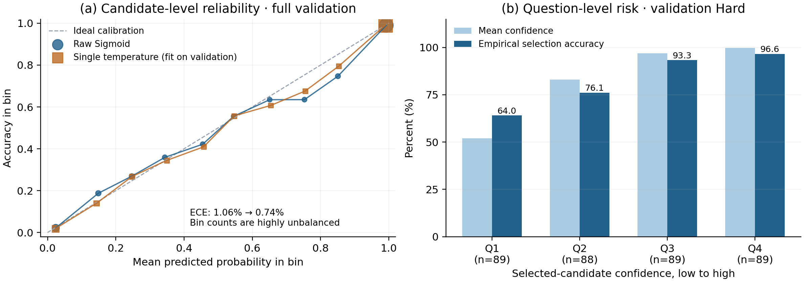

# Best-of-N Selection of Mathematical Inferences under Constrainted Resource
## From Answer Consensus to Cross-Candidate Comparison and Heterogeneous Soft Fusion

**Jieren Guan · DASE7506 MP2 · 26 October 2026**

### Abstract

This project studies how to select, from four candidate solutions to the same maths problem, one whose final answer is correct. The selector may use only the official question, the candidate texts and their fixed representations. It cannot call a language model at evaluation time. The experiments start from majority voting by final-answer frequency, then compare text features, pointwise scoring, cross-candidate attention and model fusion. A model trained only on length, formatting and confident wording scores below majority voting. Arithmetic checks improve the consensus baseline, but they do not give a stable standalone gain on the stronger representation model. The retained soft fusion of cross-candidate attention and a tree model reduces the number of errors on validation disagreement questions from 110 to 55, reaching **300/355 (84.51%)**. After freezing, the official score on the complete test split is **374/467 (80.085653%)**. Locally, the complete prediction-plus-scoring run takes **11.625 seconds**, and the inference assets occupy **6.827 MiB**. Later, more elaborate features, geometric centroids and energy ranking do not surpass the retained system. Extra computation is worth adopting only when it produces a gain that can be rechecked on the full system.

## 1. Task and evaluation: choosing among solutions already produced

The official release provides 4,755 training questions, 798 validation questions and 467 test questions. Each question contains the question text, four candidate solutions, and a fixed 1,024-dimensional representation of each candidate. The model must output one candidate index from 0 to 3. The official scorer parses that candidate's final numeric answer and compares it with the reference. This report studies **final-answer selection**, not a formal proof of every reasoning step. [E1]

The bank contains both consensus questions, where the candidates agree, and disagreement questions, where they do not. To measure selection more directly, I define the Hard subset as every question with at least two distinct valid parsed answers. The training and validation Hard subsets contain **2,114 and 355 questions**. The remaining 443 validation questions form the easy subset. The test split consists entirely of disagreement questions. Unless stated otherwise, a "Hard correct count" below means the number of validation Hard questions answered correctly, with denominator 355. Because a question may have more than one correct candidate, the expected accuracy of random selection on validation Hard is 51.06%, not 25%. Majority voting by answer frequency reaches **245/355 (69.01%)**, so that is the starting point. [E2, E4] Scoring models and feature transforms are fitted on train. Validation is used to select methods and post-processing. Early test statistics are descriptive records only. The final method was frozen before the complete test; test did not enter training, tuning or selection. [E8]

## 2. Method design and experimental route

### 2.1 What evidence can be taken from the four solutions?

Whether a candidate answer has majority support, whether the reasoning contains an incorrect equation, and whether the four vectors differ are different kinds of evidence. During development I first grouped this information into feature families, then used ablations to decide which families should enter which models. Table 1 summarises the families actually studied. It does not list every raw column.

| Feature family | What it extracts | Final use |
| --- | --- | --- |
| Answer consensus G01 | Whether the answer parses, the share of candidates with the same answer, and whether that answer is a unique or tied majority | Four dimensions retained, for structure-enhanced attention and the tree |
| Surface style G02 | Length, line count, step markers, confident wording, and length and rank relative to the other candidates | Thirteen-dimensional control; not used in the final model |
| Arithmetic and number coverage G03 | Numeric equalities in extractable calculations, error counts, and whether numbers from the question appear in the solution | Twelve dimensions retained, for structure-enhanced attention and the tree |
| Vector geometry G04 | Similarity between candidates, deviation from the within-question mean, and reduced vectors | Geometric scalars and direct centering were not retained; the tree retains 128 reduced dimensions |
| Fine-grained reasoning G05 | Whether the last calculation matches the answer, whether successive calculations connect, and collective evidence from candidates with the same answer | Six-dimensional extension; a standalone gain that did not improve the final fusion |
| Character statistics G06 | Hashed character 3/4-gram TF-IDF, so the model does not rely only on hand-specified text patterns | 4,096-dimensional text arm; did not pass the within-training screen |
| Correct/incorrect prototypes G07 | Distance to one centroid, or to several centroids, of correct and incorrect training candidates | Geometric verification arm; did not pass the within-training screen |
| Numeric answer form | Whether the answer is an integer, negative or zero, its magnitude, and whether it appears in the question | Five-dimensional supplementary control; not used in the final model |

**Table 1. Overview of the feature families.** G01–G07 are trace identifiers. They do not mean that the families were stacked, in order, into one model. Feature screening and learned statistics were computed on the training data.

### 2.2 How does the final system make one choice?

The final method is **three-view Soft Stacking**: three scorers are trained separately, and their continuous scores are fused. In the experiment records, **B17/B20 are development-batch identifiers. They do not denote depth, parameter count or fusion weights.** B17 fixed the retained fusion. B20 completed its packaging check. The inference path is:

**Question, four candidate texts and 4×1024 vectors → three scoring arms → score standardisation and weighting → validity handling → aggregation by final answer → one candidate index.**

**Arm A, representation attention.** The input is the four official 1,024-dimensional vectors. Each vector is L2-normalised, projected to 128 dimensions by a shared linear layer, passed through two layers of four-head self-attention, and mapped to one scalar score. Attention is across the four candidates, not across tokens inside a solution. The network can revise its judgement of the current candidate using the other three solutions. Each layer uses a residual connection and LayerNorm. There is no positional encoding and no extra feed-forward block. If the candidate order is permuted, the scores are permuted with it.

**Arm B, structure-enhanced attention.** This arm uses the same network, but concatenates each candidate's 1,024-dimensional vector with four consensus dimensions and twelve arithmetic and number-coverage dimensions, giving a 1,040-dimensional input. The structural features are normalised with a mean and standard deviation fitted on the training split. The arm is there so that explicit answer consensus and reasoning checks can supply information the fixed vectors may not have made prominent.

Both arms take supervision from whether the final answer is correct. They do not need step-level reasoning labels. Let the four scores of a question be \(s_1,\ldots,s_4\), the set of correct candidates be \(C^+\), and the candidate label be \(y_j\). The training objective is

\[
\mathcal L=-\log\frac{\sum_{c\in C^+}e^{s_c}}{\sum_{j=1}^{4}e^{s_j}}
+\lambda\sum_{j=1}^{4}\operatorname{BCE}(\sigma(s_j),y_j),\qquad\lambda=1.
\]

The first term encourages the scores to be assigned to any correct candidate, without making correct solutions compete with each other. The second term gives each of the four candidates its own binary supervision. Each model is trained for 10 epochs on all training questions, then fine-tuned for 8 epochs on training Hard. The optimiser is AdamW, with learning rates 0.001 and 0.0003 in the two stages and a batch size of 256. Arm A and Arm B are each trained with seeds 42, 43 and 44. Within an arm, the three models' raw scores are averaged first. [E3]

**Arm R5, gradient-boosted trees.** To introduce a decision procedure different from the attention network, the third arm uses `HistGradientBoostingClassifier`. It receives 16 raw structural features, a 64-dimensional SVD projection fitted on the training vectors, and a 64-dimensional difference obtained by subtracting the within-question mean projection from each projection: 144 dimensions in total. The first part keeps compressed candidate information. The second emphasises how a candidate differs from the other candidates on the same question. The classifier uses 100 iterations, a maximum depth of 5 and a minimum of 20 samples per leaf. The final system loads six attention models and one tree classifier.

**Fusion across arms.** The raw scores of the three arms have different scales. The system first z-scores the four scores of each arm within the question, then fuses them with a convex combination fitted on out-of-fold training scores:

\[
z_c=0.6519944\,\widetilde s^A_c+0.2773941\,\widetilde s^B_c +0.0706115\,\widetilde s^{R5}_c.
\]

Here \(\widetilde s_c\) is the standardised score. Out-of-fold scores are the model's predictions on the training questions it did not see while fitting, and they reduce the overfitting that comes from fitting directly to in-sample training predictions. The full-precision weights are stored in the frozen configuration. The difference between the historical out-of-fold implementation and the strict refit is discussed in Section 7.

Finally, the system lowers the scores of candidates that are unparseable or that have a specified parse conflict. It turns the fused scores into within-question weights with a softmax at temperature 0.5, groups candidates with the same final numeric answer into an answer cluster, and sums the weights inside the cluster. It selects the cluster with the largest total weight, then returns the candidate with the highest score inside that cluster. The rule keeps a judgement of each individual solution and also uses the consensus of several candidates supporting the same answer. The experimental basis for validity handling and aggregation is in RQ2 and RQ4.

### 2.3 What did the main experiments answer?

Table 2 organises the development route by research question. Batches that only package the system, monitor resources or run the frozen evaluation are omitted from the method comparison. Each row is a comparison from the corresponding experiment. Training protocols and post-processing may differ, so the numbers are not a leaderboard under one common setting.

| Main experiment and batch | Method and key figure | Decision | RQ |
| --- | --- | --- | --- |
| Majority voting (B01) | Select by final-answer frequency: 245 questions, 69.01% | Use as the baseline | 1, 5 |
| Feature screening and family ablations (B02–B04, B11) | Consensus linear model 245; plus surface features 247; plus arithmetic/coverage features 258 | Keep consensus and arithmetic features for further study | 1, 2 |
| Standalone surface model (B05) | Tree trained only on length, formatting and wording: 213 questions, 60.00% | Not used as a final scorer; its errors are analysed | 2 |
| Pointwise scoring and cross-candidate comparison (B06–B07) | Pointwise linear representation model 279; cross-candidate attention 294 | Take the cross-candidate network as the main architecture | 3 |
| Structural input and multi-seed checks (B08, B12) | Early representation-only model 294; 293 after structural features are added. Three-seed post-processed means: Arm A 293.67, Arm B 291.00 | The standalone gain is unstable; keep the heterogeneous arms for the fusion test | 1, 3 |
| Temperature and confidence (B09) | Candidate-level ECE falls from 1.06% to 0.74%; selection gains only one question | Evaluate calibration and selection separately | 4 |
| Tree model and hard switching (B10, B15) | SVD raises the standalone tree from 263 to 268; hard switching does not beat the neural reference | Keep the tree as a soft-fusion candidate | 5 |
| Centering, attention bias and the dual tower (B13–B14, B19) | Direct-centering mean 277.00; same-answer bias on Arm A 293.00; dual tower 276.67 | None stably beats its own reference; stop these architectural changes | 3, 5 |
| Validity handling (B16) | Arm A's three-seed mean correct count on full validation rises from 728.33 to 737.33 | Keep validity and conflict suppression | 2, 4 |
| Heterogeneous soft fusion (B17) | A+B gives 298; adding the tree gives 300; adding a linear arm gives 297 | Retain the three-view system | 5 |
| Fine-grained features and system integration (B18, B21–B22) | Structural linear model 258→262; tree 268→271; fusion after replacing the tree gives 298 | The standalone gain does not become a final-system gain | 1, 5 |
| Sample weighting and the character-text arm (B23–B24) | Outer-fold mean changes of +0.449 and −0.048 percentage points | Did not pass the internal gate; validation was not queried | 1, 5 |
| Objective and decoder alignment (B25) | Outer-fold gain of 0.752 percentage points; validation is 294 | Did not replace the three-view system | 4, 5 |
| Geometric-centroid verification (B26) | Outer-fold gain of 0.196 percentage points | Did not pass the internal gate | 3, 5 |
| Pairwise energy ranking (B27) | Outer-fold gain of 0.918 percentage points; validation is 295 | Did not replace the three-view system | 4, 5 |

**Table 2. Overview of the main method experiments.** Except for results explicitly marked as full validation or as an outer training fold, question counts are validation Hard / 355. A "mean" is the average correct count over three random seeds. The later sections explain what conclusion each comparison supports.

## 3. RQ1: Does reading the reasoning actually help?

**The experimental hypothesis is that arithmetic and condition checks supply useful evidence beyond answer consensus. The main conclusion is that they clearly improve the weaker consensus model, but do not stably raise the standalone score of the stronger representation model.**

Consider first a model that knows only final-answer frequency. It can recognise a majority, but it cannot tell "the majority all missed a condition" from "a minority produced the correct derivation". To test whether the reasoning text supplies that information, the experiment fixes training Hard, the standardisation and L2 logistic regression, and adds one feature family at a time to the four-dimensional consensus input. [E4]

The consensus baseline answers 245 questions correctly. Adding the thirteen surface-style dimensions gives 247. Adding the four-dimensional geometric summary gives 248. Adding the twelve arithmetic and number-coverage dimensions reaches **258**. In this controlled comparison, the thirteen-question gain from the reasoning checks is clearly larger than the gains from length or from the similarity summary. A feature-family shuffle of the structural tree also shows that the tree depends on both answer consensus and arithmetic information. Breaking the correspondence of the consensus features loses 37.65 questions on average. Breaking the arithmetic/coverage features loses 16.60 questions on average. This is evidence that the model depends on those inputs. It does not give each heuristic a causal interpretation.

The conclusion changes once the base model already reads a vector representation of the whole solution. In an early same-platform, single-seed comparison, representation-only attention answers 294 questions correctly. Adding consensus features gives 289, and adding arithmetic/coverage features brings the score back to 293. Arithmetic features therefore improve the arm that already has consensus, but they do not beat the representation-only model. On 52 questions where the candidates differ in number coverage, the structure-enhanced model answers 44 correctly and the representation-only model answers 41. They attend to different cues, but a local difference of three questions is not enough to establish an overall advantage.

I then added finer calculation-chain and answer-cluster features. They raise the structural linear model from 258 to 262 and the tree from 268 to 271. The new linear arm nevertheless receives zero weight in the final fusion, and the system with the replacement tree reaches only 298, below the original 300. **A feature family that improves a standalone model does not thereby complement an existing fusion.**

## 4. RQ2: What makes a wrong answer look convincing?

**The experimental hypothesis is that a model which relies only on presentation style will mistake a fully written solution for a correct one. The main conclusion is that the surface model generalises poorly, while arithmetic checks and validity handling cover part of its errors.**

To test the hypothesis, I train a gradient-boosted tree on only thirteen features: length, line count, step markers, confident wording and within-question relative features. The model cannot read whether a calculation is correct, and it does not use the official vectors. It reaches 79.94% on training Hard but only **213/355 (60.00%)** on validation Hard, below majority voting at 69.01%. Style regularities are not enough for reliable selection. [E4]

I then compare the solutions it selects correctly and incorrectly. Across 142 wrong selections, the mean character count is 637, against 566 for the correct selections. The mean step-marker count is 2.85 for wrong selections and 2.46 for correct ones. The mean confident-word count is 0.63 and 0.56. The solutions this model selects incorrectly tend to be longer, to contain more steps and to sound more confident. These are associations among selected samples. They do not by themselves prove that length causes the mistake. The controlled evidence that goes with them is from the previous section: surface features add only two questions to the consensus baseline, while arithmetic/coverage features add thirteen.

Which concrete problems can the arithmetic checks point out? Among those 142 wrong selections, the extractor finds a detectable incorrect equation in 29 and a missing question number in 16. After deduplication, the two types cover **42 selections (29.58%)**. The remaining errors cannot be fully explained by these marks. For example, reading `20% of` a price as `20% off` can leave both calculation paths arithmetically self-consistent while they use different quantitative relations. Arithmetic and number coverage are suitable as scoring evidence. They are not a hard criterion of final correctness.

Development also found another kind of candidate that is easy to select by mistake: the text appears to give the right answer, but the official parsed value is different. On a plumber question, a candidate ends with `\boxed{250}`, while the body also contains the heading `#### **Job 3**`. The official parser reads the number after `####` first, so it parses this candidate as 3. Even though the solution expresses 250 at the end, it does not score under the official protocol. [E2]

The final system adds two treatments for this kind of case. First, when a parseable candidate exists, it lowers the scores of unparseable candidates. Second, when a parseable and non-conflicting alternative exists, it lowers candidates whose official parsed value disagrees with the boxed number. The first treatment follows the scoring rule directly. The second is an empirical heuristic: the boxed number may be the part that is wrong, so the treatment is not guaranteed never to harm a correct candidate.

The validation split contains 157 unparseable candidates and eight candidates with this conflict. The official labels mark all eight conflict candidates incorrect. On the three seeds of the representation-attention arm, the two treatments raise the mean full-validation correct count from 728.33 to 737.33. The mean Hard correct count rises from 292.67 to 294.33, and the easy subset recovers from 435.67 to 443/443. The larger full-validation gain comes mainly from avoiding outputs that cannot score. This improves agreement between the selector and the evaluation protocol. It is not an equal gain in mathematical reasoning.

## 5. RQ3: Should a solution be judged on its own?

**The experimental hypothesis is that plausibility which is hard to judge in one solution can be evaluated through the disagreement exposed by the other candidates on the same question. The main conclusion is that the cross-candidate model beats this project's pointwise baseline, while further centering and interaction structures do not continue to give a stable gain.**

The first control is an independent judgement. Logistic regression and a multilayer perceptron each receive one candidate's normalised 1,024-dimensional vector, output one score, and finally choose the highest score among the four candidates. The best logistic regression among four regularisation strengths is **279/355 (78.59%)**. The multilayer perceptron answers 270 questions. The cross-candidate attention introduced in Section 2 receives all four vectors at once, so it can use both the candidate itself and the relations among candidates, and it reaches **294/355 (82.82%)**. Relative to the best linear baseline, it corrects 24 questions and newly misses 9, a net gain of 15. [E3]

These results support using the cross-candidate model as the later architecture, but they do not attribute the whole 4.23 percentage points to attention. The two models also differ in capacity, loss and training schedule. To test whether the result depends on one initialisation, I later retrain three seeds in a common Windows environment. With the Sigmoid aggregation used at that time, representation attention scores 292, 294 and 295, a mean of **293.67 ± 1.53 questions**. The structure-enhanced arm scores 294, 292 and 287, a mean of **291.00 ± 3.61 questions**. The ± quantity is the sample standard deviation of the three seeds. It describes sensitivity to initialisation. It is not a confidence interval for performance on new questions.

After the basic architecture was confirmed, I tried three more explicit ways of comparing candidates. The first subtracts the within-question mean from each candidate vector, so that the difference from the other solutions stands out. The second adds a learnable attention bias between candidates that share an answer. The third puts the vectors and the structural features into two networks and fuses them in a later layer. The three-seed post-processed mean of the directly centered model is 277.00 questions, and concatenating the original vectors with the centered differences gives 284.33. The representation-only arm with the same-answer bias scores 293.00, and the dual tower scores 276.67. None of these designs stably beats its reference, so none enters the final system. The negative results show that comparing candidates is a useful design direction, and that removing shared information more explicitly is not automatically better. Centering may discard useful information, and it may also change the difficulty of optimisation. The experiments do not measure those mechanisms directly, so the retention decision follows the scores. I do not treat any one explanation as an established cause.

Finally, two models selecting different indices does not by itself mean that their errors complement each other one for one. Two candidates may give the same correct answer. Between the early representation model and the structural model, only the 41 questions that differ in final correctness correspond to "one selects correctly and the other incorrectly". One direction corrects 20 questions and the other misses 21. That supplies a motive for fusion, and it also explains why the number of disagreements alone cannot decide which model to use.

## 6. RQ4: Can the method recognise its own uncertainty?

**The experimental hypothesis is that a higher model score should make the selected answer more reliable. The main conclusion is that the scores can separate relative risk, but a favourable candidate-level calibration figure does not mean that the question-level selection probability is already reliable.**

Two events have to be separated. "Whether one particular candidate is correct" is a candidate-level question, and each validation question contributes four samples. "Whether the candidate selected for a disagreement question is correct" is a question-level event, and each question contributes one choice. A selector is used for the second event.

The calibration experiment fixes the early structure-enhanced attention model and changes only the temperature of the Sigmoid scores. Temperature changes how sharp the probabilities are, but it does not change the ranking of individual candidates. The experiment bins the probabilities into ten equal-width intervals and compares each bin's mean probability with its empirical accuracy. ECE is the average absolute gap, weighted by the number of samples in the bin. Candidate-level ECE falls from **1.06% to 0.74%**, and NLL falls from 0.16191 to 0.16110. The temperature is fitted and diagnosed on the same validation split, so these are calibration results inside the development set. [E5]

**Figure 1. Calibration and risk stratification for the early structure-enhanced attention model.** The left panel uses all 3,192 candidates in the validation split; point area is the number of samples in the bin. The right panel divides the 355 validation Hard choices into four groups by the raw Sigmoid confidence. The figure analyses an early single model. It does not represent probability calibration of the final fusion.

In the left panel, the 0.9–1.0 probability bin contains 2,154 candidates, with a mean confidence of 99.26% and an empirical accuracy of 99.03%. That large bin is itself well calibrated, and it also makes the overall ECE small. On question-level Hard choices, however, ECE is **7.16%**. The top confidence quartile has a mean probability of **99.75%** and an empirical selection accuracy of **96.63%**, so overconfidence remains. In the other direction, empirical accuracy across the four confidence groups rises from 64.04% to 96.63%, so the scores do indicate relative risk. The two levels have different samples and different events, so the two ECE figures cannot be read as the rise and fall of one indicator.

Calibration also has to be evaluated together with the final selection rule. The earlier procedure summed the Sigmoid weights of candidates with the same answer. After adjusting the temperature and the aggregation parameters, it gains only one question over taking the highest score directly. A better probability figure does not produce a selection gain of the same size.

The final system uses a within-question softmax and groups candidates by final answer:

\[
p_c=\frac{e^{z_c/T}}{\sum_j e^{z_j/T}},\qquad P(A)=\sum_{c:a_c=A}p_c.
\]

Here \(a_c\) is the candidate's official parsed answer, and \(P(A)\) is the total weight of the answer cluster. If two candidates both answer 12, their weights jointly support the answer 12. The rule makes a continuous trade-off between independent quality scores and majority voting. It also agrees in direction with the training term that increases the total mass on correct candidates. The final system, however, standardises scores, applies validity handling and uses temperature 0.5, so the training loss and the final decision are not identical. Giving repeated answers more support is a consensus bias, and the aggregated weight has not been shown to be a calibrated probability of correctness.

## 7. RQ5: When does more computation pay off?

**The experimental hypothesis is that adding a model or a training objective can be worthwhile if different scorers repair one another's errors. The main conclusion is that a tree model with a small weight improves the soft fusion, while further features, interactions and verification arms do not stably surpass the three-view system.**

### 7.1 From hard switching to continuous fusion

Before trying three-view fusion, I first train a structural tree and then try to let it take over questions on which the neural model is uncertain. This hard switch must choose one model for each question. For example, it may use the tree when the neural score is below a threshold, or it may use whichever model looks more confident. The standalone structural tree answers only 261 questions, and several switching thresholds fail to beat the neural reference. Choosing the more confident model answers only 279. After reduced vector features are added to the tree, the standalone tree rises to 268, and hard switching still fails. [E6] Later work therefore moves to soft fusion, letting the weaker arm make a limited correction to the overall score. Table 3 uses the same validity handling and temperature 0.5, so that decoding differences are smaller. When an arm is added, the combination weights are refitted on out-of-fold training scores.

| Combination of scoring arms | Validation Hard / 355 | Full validation / 798 |
| --- | --- | --- |
| Representation attention A, three-seed mean | 296 | 739 |
| Structure-enhanced attention B, three-seed mean | 293 | 736 |
| Gradient-boosted tree R5 | 268 | 711 |
| A + B | 298 | 741 |
| **A + B + R5, retained** | **300** | **743** |
| Plus a pointwise linear representation arm | 297 | 740 |

**Table 3. Fusion comparison under the same decoding.** These are system-selection results on the validation split. Each row has its own fitted weights.

The standalone tree is far weaker than the attention models, yet it adds two questions on top of A+B. Adding a further linear arm makes the result worse. A standalone score is therefore not the only basis for judging the value of fusion, and the number of members cannot replace evidence of a gain. Relative to majority voting, the three-view system halves the number of Hard errors, but the tree's local increment is only two questions. The two pieces of evidence should not be treated as equally strong.

### 7.2 Correct the reference first, then test later changes

To give later changes a more reliable reference, the packaging stage rechecked the training out-of-fold procedure. The original procedure differs from final inference in three places: the SVD is fitted before the training folds are split; the tree's out-of-fold structural features are standardised, whereas the full tree uses the raw values; and the attention out-of-fold predictions use one seed, whereas full inference averages three seeds. All three steps involve only train, but they affect the estimated fusion weights.

On refitting, each fold fits the SVD only on that fold's training portion, the tree features use one scale, and the out-of-fold mean of three seeds matches the final procedure. The weights move from about `[0.6520, 0.2774, 0.0706]` to `[0.6401, 0.2888, 0.0711]`, and the Hard score moves from 300 to **295**. [E6] The weight change is small, but boundary questions can still change the selection. The submitted system keeps the historical combination that was selected on validation and that can be replayed question by question, and it also reports the strict-refit result, so that the two references stay distinct.

### 7.3 Later arms: why did an internal gain not remain?

Later work first screens candidates inside the training split, and only then decides whether to make one validation check. Nested screening holds out an outer set of questions for evaluation and selects parameters only on inner folds of the remaining training questions. This reduces the number of times validation is inspected directly. Hard-example weighting and the character-text arm require the outer-fold mean to improve by at least one percentage point. The later decoder, centroid and energy experiments require both the fold-mean and the pooled accuracy to improve by at least 0.5 percentage points, an improvement in at least three folds, and no drop in the full-training out-of-fold score. [E7]

| Later method | Outer-fold training Hard correct: reference → candidate / 2,114 | Fold-mean gain | Validation check and decision |
| --- | --- | --- | --- |
| Up-weight training questions previously missed | 1,640 → 1,650 | +0.449 pp | Failed the internal gate; validation not queried |
| Add a character n-gram scoring arm | 1,677 → 1,676 | −0.048 pp | Failed the internal gate; validation not queried |
| Align the training objective, score scale and answer-cluster decoding | 1,671 → 1,687 | +0.752 pp | 294 questions, against a same-protocol reference of 295; not retained |
| Add a correct/incorrect centroid arm | 1,687 → 1,691 | +0.196 pp | Failed the internal gate; validation not queried |
| Add a pairwise energy-ranking arm | 1,687 → 1,706 | +0.918 pp | 295 questions, against a same-protocol reference of 294; not retained |

**Table 4. Why the later methods stopped.** pp denotes percentage points. Each method uses its own training and decoding reference, so the numbers cannot be joined into one improvement curve under a common setting. The fold-mean and the pooled accuracy also weight questions differently.

These experiments test improvements at three levels. Sample weighting tries to concentrate training attention on questions that are easy to miss. The character arm tries to extract text regularities that the hand-built features omit. Neither passes the internal gate. Decoder alignment directly adjusts the relation among the training loss, the score scale and answer-cluster selection. It improves on the outer training folds, but validation falls from the same-protocol reference of 295 questions to 294.

**The centroid arm tests whether any simple geometric evidence is still available.** The original CLUE method compares multi-layer hidden-state differences between the start and end of a reasoning trace. This project does not have those states and can only make a restricted adaptation to the official full-solution vectors. [P1] On the valid Hard candidates of each training fold, the experiment balances the correct and incorrect class weights within each question, then fits a single correct centroid and a single incorrect centroid, and also a similarity mixture of four centroids per class. For a new candidate, it compares which kind of prototype is closer and adds that score to the fusion. On the outer training folds it adds only four questions, and only two folds improve, so it stops. The squared-distance gap between two single centroids can be rewritten as a linear score on the vector. The absence of gradient training does not by itself mean that the method supplies information wholly different from attention.

**The energy arm tests whether changing the training objective is more effective.** The idea taken from EORM is to train the ranking between correct and incorrect candidates from outcome labels, rather than to introduce extra step-level labels. [P2] This project keeps the input and architecture of representation attention, and compares the original listwise+BCE objective, Bradley–Terry pairwise ranking, and pairwise ranking plus BCE. The pairwise objective requires a correct candidate to score above an incorrect candidate on the same question. Energy is defined as the negative of the score.

The selected energy arm improves all five outer folds, for a total gain of nineteen questions. After it reaches validation, the fused system answers only 295 questions. Relative to the 294-question reference it uses, it corrects six questions and newly misses five. The three paired seeds change by −2, −2 and +1. A small and unstable change is not enough to replace the original 300-question system. An improvement in ranking also cannot be read directly as an improvement in probability calibration. The geometric arm does not pass the screen, and the planned joint geometry-and-energy experiment is not run.

### 7.4 The cost of computation and the boundary of development choices

The main neural models are trained on one RTX 4060 Laptop GPU. The early attention experiments use Mac MPS, and the tree uses CPU. Fitting the final six attention models is recorded at 16.72 seconds. Adding the three-seed, five-fold recheck, 36 fits take 74.16 seconds in total. The later training and search batches for five arms take about 12 minutes 52 seconds, of which decoder alignment takes 220.75 seconds, the centroid arm 28.18 seconds and the energy arm 281.56 seconds. The extra computation does not become a higher final validation score. [E9]

Development-set scores also have to be read with the selection history in mind. Across only the six groups of batches for multi-seed checks, architectural changes, the tree, validity handling and soft fusion, 982 validation configurations are recorded. These include temperature and fusion combinations. They are not 982 independent training runs. Multi-seed checks can reveal unstable initialisation, and within-training screening can reduce new validation queries, but neither removes the repeated validation selection that has already happened. The highest validation score is therefore used to decide the frozen method. The frozen test then supplies the final score, without further selection on the basis of that score.

## 8. Final test, resources and an external reference

### 8.1 Complete test result after freezing

The final system first replays the retained method question by question on the validation split, giving **Hard 300/355 and full validation 743/798**. The code, models and configuration are then fixed, and one complete primary test run and one scheduled reproduction are executed. **Both complete test runs have the official score 374/467, accuracy = 80.08565310492506%.** The two runs have the same question order and the same candidate choice on every question. [E8] Validation Hard at 84.51% and test at 80.09% differ by 4.42 percentage points. The validation Hard subset and the test split may differ in solution patterns and error composition, and repeated validation selection may also have inflated the development score.

### 8.2 Resource cost of the complete evaluation

The resource measurement is made locally on Windows 11, an AMD Ryzen 9 7940HX and about 32 GB of memory. Numeric libraries are fixed at one thread, and inference uses the CPU. Each measurement starts a fresh prediction process and then starts a separate official scoring process. The outer timing includes process startup, imports, loading of inputs and models, feature extraction, computation by every model, output and scoring.

| Fixed run | Prediction process | Scoring process | Continuous wall-clock |
| --- | --- | --- | --- |
| Primary | 11.0942 s | 0.5155 s | **11.6255 s** |
| Scheduled reproduction | 11.0784 s | 0.5130 s | **11.6061 s** |

**Table 5. Local resource measurements for the complete test.** The continuous wall-clock includes the gap between the two processes and the original software-audit overhead. Both runs start from fresh processes. There is no warm-up and no selection of the fastest run.

The nine inference assets contain all attention weights, structural normalisation statistics, the SVD, the tree model and the configuration. Expanding the NPZ members and including array headers gives **7,135,173 B**. Summing, for each file, the larger of its stored size and its expanded size gives the conservative total **7,158,695 B (6.8271 MiB)**, below the 16 MiB limit. Both local complete runs finish in under 30 seconds. The specified Xeon Platinum 8457C was not measured. The figures above are local results under the stated hardware and the single-thread setting. [E8]

### 8.3 An independent external capability reference

To see how large a gap a stronger problem-solving ability might leave, I make a separate external analysis of the validation split. Through an API, it uses `gpt-6.1-sol` at a high reasoning-effort setting and covers all 798 validation questions. When it is asked to judge the four candidates directly, Hard is **342/355 (96.34%)**. When its own solved answer is matched back to the candidates, Hard is **351/355 (98.87%)**. The answers the model generates itself are also correct on 351 Hard questions, so the model itself has strong direct problem-solving ability. [E2]

The important difference between this independent reference and the in-rule systems in this project is the information channel and the source of ability. The local selector can learn only from the question, candidate texts, fixed vectors and training data allowed by the rules. The external model can use its own large-scale pretrained knowledge and can solve the problem independently. Although the reference reading comes from the same validation questions, it is not a method comparison under the same information and resource conditions, and it cannot be used to estimate the gain a local component ought to have. The requests in this 798-question reference session span about **15 minutes 21 seconds** from the first to the last, and the mean request time per question is about 8.30 seconds.

Compliance statement: this external reference is fully separate. Its code, outputs and labels do not enter local training, in-rule method selection or the frozen inference. [E2, E9]

### 8.4 Submitted materials

In the submitted directory, `code/` keeps the official data and evaluation tools. The only editable file, `submission.py`, is connected to the final entrypoint. `frozen/` keeps the frozen implementation, the matching nine assets, and the score and resource records. `development/` keeps the development source, tests and experiment archive. Installation, checkpoint reproduction, the historical training source and the boundary of the archived scripts are given together in [readme_reproduction.md](readme_reproduction.md). Hashes of the files actually submitted are in [frozen/manifest.json](../frozen/manifest.json).

## 9. Development summary and conclusions

### 9.1 Route and workload

This is a candidate-selection task under a restricted information channel. The aim is to recognise which of four solutions already produced is worth selecting, not to generate another mathematical solution. Development first establishes the majority-voting baseline, then uses family-by-family ablations to test consensus, surface style and arithmetic evidence. It next moves from pointwise vector scoring to cross-candidate attention, and checks stability with multiple seeds. The surface model, direct centering, the same-answer bias and the dual tower do not produce a stable gain, so they stop. Representation attention, structure-enhanced attention and the gradient-boosted tree enter the soft-fusion comparison, and the three-view system is retained. Finer symbolic features, sample weighting, character text, centroids and energy ranking continue to receive system-level tests, but none replaces the frozen version.

By the recorded numbering, the project completes **26 feature and method research batches**, plus two packaging and freeze-validation batches, while one conditional joint experiment is skipped. The development archive in the current submission contains **30 batch-named experiment and validation scripts, 68 Python source files and 35 Python test files**. The batch scripts are included in the 68 source files and are not counted again. The experiment archive contains **147 JSON result, configuration and validation records**, of which the audit, candidate-selection and score directories together contain 102, plus three JSONL caches of the external reference calls. [E9]

### 9.2 Research conclusions

First, arithmetic and number-coverage evidence in the reasoning text raises the consensus linear baseline from 245 to 258 questions, but it does not stably raise the standalone score of the stronger representation model. Its value has to be tested separately in a particular model and in the fusion.

Second, cross-candidate attention beats this project's pointwise baseline. Surface style is not enough for reliable selection, while validity handling and aggregation by answer can remove mistakes that were otherwise avoidable. The scores can separate high and low risk, but good candidate-level calibration cannot replace question-level validation.

Third, heterogeneity sometimes matters more than which member is stronger alone. With a small weight, the tree helps the three-view system reach **84.51% validation Hard accuracy**, but adding further arms does not continue to help. Development ends at **80.09% complete-test accuracy, about 11.625 seconds for the local complete evaluation, and 6.827 MiB of assets**. The positive results show which evidence is worth keeping. The negative results bound the improvements that were effective under this data, these models and this resource limit.

### 9.3 AI assistance and method sources

AI assistance was used for experiment planning, implementation, review and preparation of the report. The author is responsible for understanding the implementation, making the research decisions and checking the results. CLUE and EORM are used only as sources of the ideas for centroid verification and pairwise ranking. Their pretrained weights and external training data are not introduced. [P1, P2] The official GSM8K and Qwen3-0.6B data and representation attribution, together with LICENSE and NOTICE, are retained. [E1]

---

### Evidence and references

The links below are relative to this report. Batch identifiers trace the research records. The body organises its conclusions by method and comparison.

- **[E1]** Official [task and constraints](../guide/GUIDE.md) and [running protocol](../code/README.md).
- **[E2]** [External reference and random/oracle baselines](../development/runs/audit_logs/exp_r01_judge_audit.json), [method disagreements](../development/runs/audit_logs/exp_r02_headroom_audit.json) and [validation cases](../development/runs/ref/residual_review.json).
- **[E3]** [Pointwise scoring B06](../development/runs/audit_logs/exp_b06_pointwise_audit.json), [cross-candidate attention B07](../development/runs/audit_logs/exp_b07_cross_attn_audit.json), [multi-seed check B12](../development/runs/audit_logs/exp_b12_seed_ensemble_audit.json) and the [seed registry](../development/runs/audit_logs/seed_registry.json).
- **[E4]** [Consensus baseline B01](../development/runs/audit_logs/audit_EXP-B01_validation_20261017_145535.json), [controlled ablation B04](../development/runs/audit_logs/exp_b04_ablation_audit.json), [surface features B05](../development/runs/audit_logs/exp_b05_surface_audit.json), [reasoning features B08](../development/runs/audit_logs/exp_b08_reasoning_audit.json), [feature-family shuffle B11](../development/runs/audit_logs/exp_b11_family_shuffle_audit.json) and [validity handling B16](../development/runs/audit_logs/exp_b16_masking_audit.json).
- **[E5]** [Calibration B09](../development/runs/audit_logs/exp_b09_calibration_audit.json). Figure 1 is [calibration_diagnostics.png](calibration_diagnostics.png).
- **[E6]** [Hard switching B10](../development/runs/audit_logs/exp_b10_fusion_audit.json), [tree/SVD B15](../development/runs/audit_logs/exp_b15_tree_audit.json), [soft fusion B17](../development/runs/audit_logs/exp_b17_soft_stacking_audit.json) and [strict out-of-fold refit B20](../development/runs/audit_logs/exp_b20_oof_audit.json).
- **[E7]** Later screening: [sample weighting](../development/runs/audit_logs/exp_b23_hard_weighting_audit.json), [character arm](../development/runs/audit_logs/exp_b24_char_ngram_audit.json), [decoder alignment](../development/runs/audit_logs/exp_b25_decoder_alignment_audit.json), [centroid arm](../development/runs/audit_logs/exp_b26_centroid_audit.json) and [energy arm](../development/runs/audit_logs/exp_b27_energy_audit.json).
- **[E8]** [Frozen scoring B29](../development/runs/audit_logs/exp_b29_freeze_audit.json), [resource report](../development/runs/exp_b29/resource_report.json), [reproduction report](../development/runs/exp_b29/reproduction_report.json) and [asset inventory](../development/runs/exp_b29/asset_inventory.json).
- **[E9]** Development workload, timings and reference-session counts reported in Sections 7.4 and 9.1. The one-off tally files are not part of this submission.
- **[P1]** Liang et al. (2025). [Clue: Non-parametric Verification from Experience via Hidden-State Clustering](https://arxiv.org/html/2510.01591v1).
- **[P2]** Jiang et al. (2025). [Learning to Rank Chain-of-Thought: Using a Small Model](https://arxiv.org/html/2505.14999v3).
